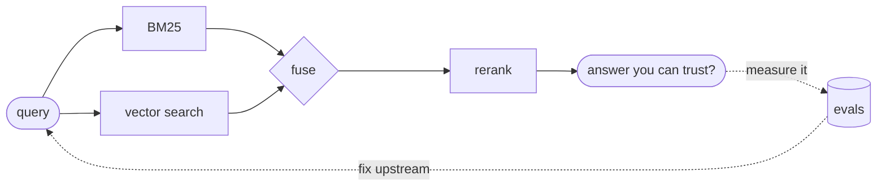

<h1 align="center">Hi, I'm Sharleen 👋</h1>

  <b>AI engineer · Nairobi 🇰🇪 · ex-Microsoft</b> 
  <i>I build AI systems, and then I try very hard to break them.</i>

  
  
  
  

---

### 🧭 What I do

Three years at Microsoft working on search and recommendation for Microsoft 365 Copilot taught me that the hard part
of AI is rarely the model. It's knowing whether a change actually helped. Now I build LLM apps, retrieval and agents
end to end, with the evaluation to match.

### 🛠️ Things I've built

| Project | What it does |
|---|---|
| [**Netflix-Relevance-Project**](https://github.com/SBusienei/Netflix-Relevance-Project) | Hybrid retrieval over 8,807 titles, built to be broken and measured |
| [**sloth-archivist**](https://github.com/SBusienei/sloth-archivist) | An offline photo triager: rules first, a local vision model second, and it never deletes anything 🦥 |
| [**04-housing-data-analysis**](https://github.com/SBusienei/04-housing-data-analysis) | Hotel cancellation risk with SQL-first analysis and leakage-safe validation |
| [**05-jobs-extractor**](https://github.com/SBusienei/05-jobs-extractor) | Turning messy job posts into validated JSON (in progress) |

### 🧪 Currently

- 🔬 Learning RAG, LLM evals, MCP, deployment and observability, in public
- ✍️ Getting back to writing on [Medium](https://medium.com/@sbusienei) and [DEV](https://dev.to/sbusienei)
- 🌍 Open to AI engineering roles anywhere

### 🎲 Fun facts

- I speak English and Swahili fluently, and some French 🗣️
- 2023 [Deep Learning Indaba](https://deeplearningindaba.com/) scholar in Accra 🇬🇭
- I believe the ranking function is rarely where the bug is. Check upstream first.

Say hi on LinkedIn, the coffee is on whoever replies first ☕

